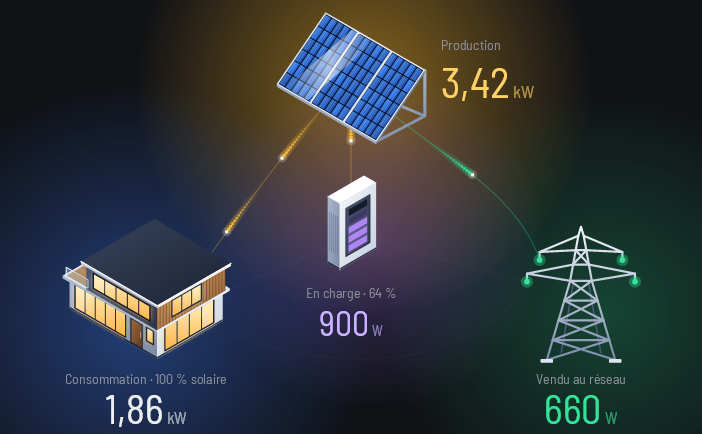
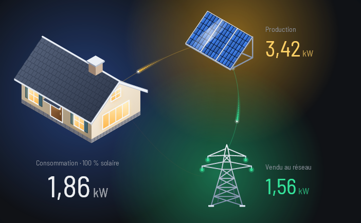
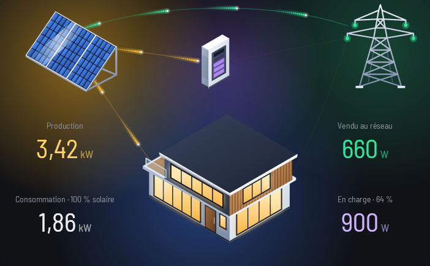
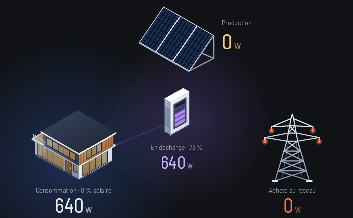
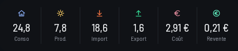
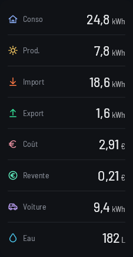
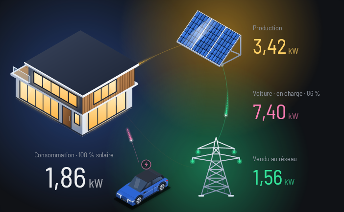

# Home Assistant, module pour Ashboard Vision

<p align="center">
  
</p>

Un module pour **Ashboard Vision**, le logiciel de l'écran Thermalright Trofeo Vision. Il lit ton installation dans **Home Assistant** et affiche ce qui se passe dans ton installation solaire : la production des panneaux, ta consommation, ce que tu achètes ou vends au réseau, et ta batterie si tu en as une. Les flux de courant sont dessinés et animés entre les panneaux, la maison et le réseau. Il affiche aussi un **bilan du jour** : ta consommation, ta production, ce que tu achètes et vends, ce que ça coûte, le gain de la revente, la recharge de ta voiture et ton eau.

Le module **ne fait que lire** Home Assistant. Il n'envoie aucune commande et n'écrit rien dans ta configuration.

> Ce module n'est **pas affilié au projet Home Assistant**. C'est un module de la communauté pour Ashboard Vision.

## Ce qu'il affiche

Chaque case affiche l'une de ces deux cartes, au choix :

- La carte **Flux d'énergie** : les panneaux, la maison, le réseau et, si tu en as une, la batterie.
- La carte **Bilan du jour** : les totaux de la journée, en bande ou en liste. Voir la section [Bilan du jour](#bilan-du-jour).

| Maison à gauche, sans batterie | Maison en bas, avec batterie | La nuit, sur batterie |
|:---:|:---:|:---:|
|  |  |  |

*Images rendues par le module, avec des valeurs d'exemple.*

| Bilan du jour, en bande | Bilan du jour, en liste |
|:---:|:---:|
|  |  |

*Images rendues par le module, avec des valeurs d'exemple.*

Pour la carte Flux d'énergie :

- Une **voiture électrique** facultative, posée au sol près de la maison, avec la puissance de sa recharge. Voir la section [Voiture électrique](#voiture-électrique).
- Trois dispositions : pointe du triangle en haut, maison à gauche, ou maison en bas.
- Deux styles de maison : contemporaine ou traditionnelle.
- Trois thèmes, pour les deux cartes : classique, liquid-glass et pixel.
- Trois tailles : 5 × 3 (minimum et compacte), 6 × 4 (idéale) et 8 × 4 (grande). Cette carte a besoin d'au moins 5 × 3. Le bilan du jour accepte des cases plus petites.

## Ce qu'il ne fait pas

- Il ne pilote rien : pas de commande, pas d'écriture dans Home Assistant.
- Il ne lit pas la configuration Énergie de Home Assistant. Tu indiques toi-même les capteurs à utiliser.
- Il ne prend pas en charge Home Assistant installé **sur le même PC** que l'application. Pour ce cas, l'adresse `localhost` ou `127.0.0.1` est refusée, avec un message qui te l'explique.
- Il ne trace ni graphique ni historique : le bilan montre les totaux d'aujourd'hui, pas leur évolution.
- Il ne calcule pas le coût à partir d'un tarif : le coût vient d'un capteur que tu choisis.
- Il ne remet pas les totaux du jour à zéro : c'est Home Assistant qui le fait.

## Installer le module

Télécharge le fichier `.avmod` de la dernière version, puis double-clique dessus. Ashboard Vision affiche alors ce que le module demande, et tu coches les permissions une à une (voir plus bas).

## Créer la clé API

Le module se connecte à Home Assistant avec une clé d'accès longue durée :

1. Dans Home Assistant, ouvre ton **profil** (en bas du menu latéral).
2. Va dans l'onglet **Sécurité**.
3. Dans la section **Jetons d'accès longue durée**, crée un jeton et donne-lui un nom, par exemple « Ashboard Vision ».
4. **Copie-le tout de suite** : Home Assistant ne l'affiche qu'une seule fois. Colle-le ensuite dans le champ « Clé API » des réglages du module.

Garde cette clé pour toi. Elle donne accès à ton Home Assistant.

## Réglages

Les réglages se trouvent dans la fenêtre de réglage de la case. La clé API est masquée et partagée par toutes les cases du module : tu la saisis une seule fois. L'adresse s'affiche en clair ; si tu laisses son champ vide, le module reprend la dernière adresse utilisée.

### Connexion

- **Adresse de Home Assistant** : par exemple `192.168.1.10:8123` ou `https://maison.exemple.fr:8123`. Sans schéma, le module suppose `http://` : si ton Home Assistant est en HTTPS, écris bien `https://` au début. Indique aussi le port : Home Assistant utilise le 8123 par défaut, même en HTTPS, sauf s'il est derrière un reverse proxy. La barre oblique finale est retirée toute seule.
- **Clé API** : le jeton créé plus haut.
- **Tester la connexion** : le bouton vérifie l'adresse et la clé, puis te dit ce qui marche ou ce qui coince (adresse injoignable, clé refusée, permission manquante).

Si tu te connectes en `https` à une adresse privée (réseau local, `.local`, `.lan` ou nom sans point), le module mémorise le certificat à la première connexion, car c'est souvent un certificat auto-signé. Si ce certificat change, le module te le signale : le bouton **Oublier le certificat** efface celui qui est mémorisé, et il sera appris de nouveau à la prochaine connexion.

### Affichage et disposition

- **Affichage** : « Flux d'énergie » (par défaut) ou « Bilan du jour ». Le bilan a ses propres réglages, décrits dans la section [Bilan du jour](#bilan-du-jour).
- **Disposition** : pointe en haut (par défaut), maison à gauche ou maison en bas. Pour la carte Flux d'énergie seulement.
- **Style de maison** : contemporaine (par défaut) ou traditionnelle. Pour la carte Flux d'énergie seulement.

### Capteurs

Tous les capteurs se choisissent dans une liste : tape quelques lettres de leur nom, le module affiche 5 propositions, avec leur valeur actuelle et leur identifiant. Les capteurs de puissance doivent être en W ou en kW.

**Production (obligatoire)** : le capteur de puissance de tes panneaux. Sa valeur est positive.

**Réseau**, avec deux formats au choix :

- **Un seul capteur** (par défaut) : il est positif quand tu **achètes** du courant. Si le tien est positif quand tu **vends**, coche « Positif à la vente ».
- **Deux capteurs, achat et vente** : « Capteur réseau » est celui de l'achat, et « Capteur de vente » est l'autre. Leurs valeurs sont toujours positives. Si tu avais rempli l'ancien champ d'achat, il continue de marcher tant que « Capteur réseau » est vide.

**Consommation (facultatif)** : si tu n'en choisis pas, le module la calcule à partir de la production, du réseau et de la batterie. Si tu en choisis un, c'est lui qui compte.

**Batterie** : par défaut, « Pas de batterie », et aucun autre champ batterie n'apparaît. Si tu en as une, deux formats :

- **Un seul capteur de puissance** : il est positif quand la batterie se **décharge** (par défaut). Si le tien est positif quand elle **charge**, coche « Positif en charge ».
- **Deux capteurs, charge et décharge** : un capteur pour la charge, un pour la décharge. Leurs valeurs sont toujours positives.

Dans les deux cas, tu peux ajouter le **niveau de la batterie, en %**. Sans lui, la jauge reste éteinte et le pourcentage n'est pas affiché.

### Voiture électrique

<p align="center">
  
</p>

Pour la carte Flux d'énergie seulement. Par défaut, « Pas de voiture » : aucun autre champ voiture n'apparaît. Avec « Une voiture », une petite voiture électrique est dessinée au sol, près de la maison, avec un flux de courant rose de la maison vers elle. Cinq réglages :

- **Voiture électrique** : « Pas de voiture » (par défaut) ou « Une voiture ».
- **Capteur de puissance de recharge** : la puissance que tire la voiture, en W ou en kW, par exemple `sensor.car_power`. C'est le seul capteur obligatoire.
- **Capteur « voiture branchée » (facultatif)** : un capteur on/off qui dit si la voiture est branchée, par exemple `binary_sensor.car_plug`.
- **Niveau de la voiture, en % (facultatif)** : par exemple `sensor.car_soc`. Sans lui, le pourcentage n'est pas affiché.
- **Couleur de la voiture** : bleu vif (par défaut), jaune ou blanc nacré.

La consommation de la maison **comprend déjà** la recharge de la voiture : le module ne l'ajoute jamais à ce chiffre. Le flux rose va de la maison vers la voiture, comme une part de ce que la maison consomme.

La voiture a trois aspects :

- **Débranchée** : la voiture est atténuée, sans badge ni flux, et sa valeur est en gris.
- **Branchée** : un badge de prise apparaît, le flux est une ligne très discrète, et la valeur est en rose pâle.
- **En charge** : un badge éclair rose pulse, le flux rose est animé, et la valeur est en rose.

Le texte de la voiture suit l'aspect : « Voiture · en charge · 86 % », « Voiture · branchée · 86 % » ou « Voiture · débranchée · 86 % ». Le pourcentage n'apparaît que si tu as choisi le capteur de niveau.

La voiture est **en charge** dès que sa puissance lue atteint **50 W**, quoi que dise le capteur « branchée ». Ce seuil évite qu'un petit bruit de mesure fasse passer la voiture en charge. Sans capteur « branchée », une voiture qui ne tire rien est montrée « débranchée » : le module ne peut pas savoir qu'elle est branchée sans cela.

Si la puissance est « indisponible » ou « inconnue », la valeur affiche « — » et la carte reste en ligne. Si le niveau est inconnu, le pourcentage disparaît.

### Ce qui se passe quand un capteur ne répond pas

- Une production « indisponible » ou « inconnue » compte pour 0, sans erreur : beaucoup d'onduleurs s'éteignent la nuit.
- Si le capteur réseau ne répond pas, la carte passe en « hors ligne » et te dit quel capteur pose problème.
- Après trois lectures ratées de suite, la carte passe en « hors ligne » avec la cause. Les valeurs restent affichées, atténuées, et la carte revient d'elle-même dès que Home Assistant répond de nouveau.
- Une clé refusée (401) te demande de refaire une clé API. Un capteur introuvable (404) est signalé par son nom.

Une case sans réglage, ou dont un capteur obligatoire est vide, reste « non configurée » : le module ne tente aucune connexion et te dit quel champ remplir.

## Bilan du jour

La carte **Bilan du jour** montre les totaux de la journée, en petit. Choisis-la dans **Affichage**, puis choisis sa forme.

### Forme et tailles

- **Bande, une ligne** (par défaut) : une colonne par valeur, avec l'icône, le nombre et le nom. Elle demande au moins 4 × 1.
- **Liste, en hauteur** : une ligne par valeur, avec l'icône, le nom, et le nombre à droite. Elle demande au moins 2 × 3. Dans une case plus haute, les lignes s'étalent sur toute la hauteur : une case de 2 × 4 tient les huit valeurs à l'aise.

Si la case est plus petite que la forme choisie, elle affiche un court message qui te dit la taille minimale.

### Valeurs et ordre

Le réglage « Valeurs à afficher et ordre » te laisse cocher les valeurs à voir, et les ranger dans l'ordre qui te plaît. Les huit sont cochées par défaut, dans cet ordre :

- **Consommation** et **production** ;
- **Import** (ce que tu achètes au réseau) et **export** (ce que tu vends) ;
- **Coût** ;
- **Gain de revente** ;
- **Voiture** (l'énergie donnée à ta voiture) et **eau**.

Une valeur non cochée n'apparaît pas. Si aucune valeur cochée n'a de capteur, la case reste « non configurée » et te demande d'en choisir un.

### Capteurs

Chaque valeur a son capteur, à choisir dans la liste :

- les capteurs de consommation, de production, d'import et d'export **du jour** : des capteurs d'énergie, en Wh, kWh ou MWh (convertis en kWh) ;
- le capteur de recharge de la voiture **du jour** : un capteur d'énergie, comme les précédents ;
- le capteur d'eau **du jour** : en litres ou en m³. L'eau s'affiche toujours en litres entiers, par exemple « 182 L » ; les m³ sont convertis ;
- le capteur de coût **du jour** : un capteur monétaire, en € ou EUR.

Un capteur d'énergie sans unité est lu comme des kWh, un capteur d'eau sans unité comme des litres. Dans la liste, les capteurs dont le nom ou l'identifiant contient « jour », « today » ou « daily » passent en premier, et chaque proposition affiche sa valeur actuelle : vérifie-la avant de valider.

Ces capteurs doivent donner des **totaux du jour**, qui repartent de zéro tout seuls chaque jour. C'est Home Assistant qui les remet à zéro, pas le module. Un compteur qui ne s'arrête jamais ne convient pas.

### Gain de revente

Le gain de revente vaut l'export du jour multiplié par le prix de revente. Il a donc besoin du capteur d'export du jour. Choisis le prix dans « Prix de revente » :

- **Aucun** (par défaut) : pas de gain. La valeur n'apparaît pas, même cochée.
- **Saisi** : tape ton prix en €/kWh, par exemple `0,13` ou `0.13`. Un prix de 0 est accepté et donne un gain de 0,00 €. Un prix vide, invalide ou négatif fait afficher un tiret à la place du gain.
- **Capteur Home Assistant** : choisis le capteur du prix. Il accepte `€/kWh`, `EUR/kWh` et `c€/kWh` (converti en euros). Sans unité, le prix est lu comme des €/kWh.

### Lecture

Le bilan relit ses capteurs toutes les 30 secondes. Une valeur dont le capteur est « indisponible » ou « inconnu », ou qui n'est pas un nombre, affiche un tiret à sa place, sans faire passer la carte hors ligne. Les autres erreurs (clé refusée, capteur introuvable, échecs répétés) se comportent comme pour la carte Flux d'énergie, décrites dans « Ce qui se passe quand un capteur ne répond pas ».

## Permissions

Le module demande deux permissions, et tu coches celle qui correspond à ton cas :

- **`reseau-local`** : ton Home Assistant est sur ton réseau local, à une adresse IP (par exemple `192.168.1.10`).
- **`internet`** : ton Home Assistant est accessible par un nom de domaine public, par exemple en `https`.

Si aucune des deux n'est accordée, le module ne se connecte pas et te demande d'en cocher une. Le module ne reçoit jamais plus que ce qu'il déclare, ni plus que ce que tu as accordé.

Un nom d'hôte ne permet pas de savoir laquelle des deux est utile. Si la connexion échoue avec un nom d'hôte, vérifie d'abord les permissions.

Même avec une adresse IP locale, `reseau-local` peut ne pas suffire. Windows ne range un appareil dans le réseau local que s'il est sur le sous-réseau d'un réseau marqué comme approuvé. Tout le reste compte comme Internet, notamment dans ces cas :

- le type de profil de ta connexion est **Public** ;
- Home Assistant est sur un autre sous-réseau, sur un VLAN ou derrière un VPN.

Si c'est ton réseau à la maison, passe ta connexion en **Privé** : Paramètres, Réseau et Internet, propriétés de la connexion, « Type de profil réseau ». Sinon, coche `internet` en plus de `reseau-local`, que le module demande pour toute adresse IP locale.

## Dépannage

- **« Clé refusée »** : la clé a été révoquée ou n'est pas la bonne. Crée-en une nouvelle dans ton profil Home Assistant, onglet Sécurité, et colle-la dans les réglages.
- **« Le nom … est introuvable »** : l'adresse est mal écrite, ou ce PC ne connaît pas ce nom. Vérifie qu'elle s'ouvre dans un navigateur sur ce PC.
- **« Rien ne répond sur le port … »** : Home Assistant écoute sur un autre port, souvent le 8123, même en HTTPS.
- **« … a coupé la connexion en http »** : ton Home Assistant est en HTTPS. Commence l'adresse par `https://`.
- **« Windows bloque la connexion »** ou **« Home Assistant ne répond pas »** : vérifie l'adresse, puis les permissions. Avec un nom de domaine, coche `reseau-local` et `internet`, car Windows décide selon l'adresse IP réelle derrière le nom.
- **« Le serveur a répondu l'erreur … »** : Home Assistant ou son reverse proxy est en panne ou encore en train de démarrer.
- **« Home Assistant est injoignable »** : les autres cas. Vérifie l'adresse, le port (8123 par défaut), et la permission `reseau-local` ou `internet`.
- **Ça ne marche qu'avec `internet` coché, alors que l'adresse est locale** : Windows ne considère pas ce réseau comme local. Voir [Permissions](#permissions).
- **Un capteur est introuvable** : son identifiant a changé dans Home Assistant. Choisis-le de nouveau dans la liste.
- **Le certificat a changé** : utilise le bouton **Oublier le certificat**, puis teste la connexion.

## Pour les développeurs

Il faut le SDK d'Ashboard Vision (`AshboardVision.Sdk`, version 1.0.0) et .NET 10.

```
dotnet build -c Release
dotnet test
ashboard-module check HomeAssistant/bin/Release/net10.0 --out check-out
ashboard-module pack HomeAssistant/bin/Release/net10.0 --out pack-out
```

- `ashboard-module check` lance le module comme le logiciel le fait, et écrit une image PNG par taille et par thème dans `check-out`. Il conclut à la fin si le module est compatible.
- `ashboard-module pack` fabrique `macorou.home-assistant-<version>.avmod` et son empreinte `.sha256`, à joindre à une version GitHub dont l'étiquette est `v<version>`.

L'icône `HomeAssistant/icon.png` est produite par le test `WriteIcon` : `WRITE_ICON=1 dotnet test --filter IconTests`. Sans cette variable, le test vérifie seulement que l'icône existe et fait 256 × 256 pixels.

L'identifiant du module (`id` du manifeste) est définitif après la première publication : c'est lui qui relie la disposition et les réglages de l'utilisateur à ton module. Si tu passes à un SDK plus récent, change le numéro dans `HomeAssistant/HomeAssistant.csproj` **et** le champ `sdk` du manifeste, ensemble.

## Licence

Ce module est distribué sous licence **GPL-3.0-or-later**. Le texte complet est dans le fichier [LICENSE](LICENSE).

Les icônes de la voiture et de la goutte d'eau viennent de [Tabler Icons](https://tabler.io/icons), sous licence MIT (Copyright (c) 2020-2024 Paweł Kuna). Leur licence est dans [HomeAssistant/THIRD-PARTY-NOTICES.txt](HomeAssistant/THIRD-PARTY-NOTICES.txt), et ce fichier est livré avec le module.
